# Overview

The Mzuri Plastics Inventory Management System is a web-based application built as a final-year academic software engineering project. It was designed to improve inventory management, record keeping, and operational information management for Mzuri Plastics, a manufacturing organization with approximately 58 employees.

# Problem

Mzuri Plastics relied on manual inventory tracking processes, which led to inefficiencies in record keeping, stock visibility, and operational information management. The organization needed a centralized system to track inventory movements, manage records, and support data-driven operational decisions.

# Objectives

- Design and implement a web-based inventory management system.
- Improve accuracy and efficiency of inventory record keeping.
- Provide operational information management for decision-making.
- Support inventory workflows including stock intake, issuance, and reporting.

# Requirements Gathering

Requirements were gathered through:
- Questionnaires administered to 18 employees.
- Direct observation of existing workflows.
- A manager interview to understand operational constraints and needs.

# Architecture

The application follows a traditional server-rendered Django architecture:

- **Frontend:** HTML, CSS, and Bootstrap templates rendered by Django.
- **Backend:** Django views and models handling business logic and data access.
- **Database:** MySQL database storing inventory records, transactions, and operational data.

```mermaid
flowchart TD
    A[User] --> B[Django Web Application]
    B --> C[HTML/CSS/Bootstrap Templates]
    B --> D[Django Models & Views]
    D --> E[(MySQL Database)]
    E --> F[Inventory Records]
    E --> G[Transaction History]
    style B fill:#11161d,stroke:#4cc9f0
    style E fill:#11161d,stroke:#4cc9f0
```

# Implementation

The system was implemented using Django's model-template-view (MTV) pattern. Python was used for application logic, MySQL for data persistence, and Bootstrap for responsive frontend styling. Requirements findings from questionnaires, observation, and the manager interview directly informed the feature set.

# Testing

System testing was performed to validate inventory workflows, record accuracy, and operational reporting. Testing focused on confirming that the system met the requirements identified during the gathering phase.

# Limitations

Quantified operational improvements (for example, percentage reductions in stock discrepancies or time savings) were not measured and are not claimed, consistent with honest reporting of completed academic work.

# Lessons Learned

- Requirements gathering through multiple methods (questionnaires, observation, interviews) produces a more complete understanding of user needs.
- Aligning system features directly with observed workflows increases adoption likelihood.
- Separation of concerns via Django's MTV pattern keeps application logic maintainable.

# Future Work

- Add role-based access control for different staff levels.
- Implement automated inventory alerts for low stock.
- Add reporting dashboards with data visualization.
- Deploy to a production environment with proper backup and monitoring.
