# Overview

"Responsible Generative AI for Customer Service: A Governance-Integrated Framework for Bias Mitigation and Explainability" is an applied AI research framework exploring how customer service systems built on generative AI can be governed responsibly. The work was submitted to the ICTM 2026 conference proceedings at UTAMU.

# Problem

Generative AI customer service systems can produce biased, unsafe, or unexplained responses, and may mishandle personally identifiable information (PII). Organizations deploying LLMs in customer-facing roles need governance controls for bias mitigation, explainability, privacy, and oversight.

# Objectives

- Explore a governance-integrated framework for responsible generative AI in customer service.
- Address bias mitigation, explainability, privacy, and human oversight.
- Integrate retrieval-augmented generation (RAG) with vector search for grounded responses.
- Evaluate model outputs for toxicity and natural language inference consistency.

# Technical Architecture

The framework combines a Django web application with an LLM backend, vector store, and governance layers:

- **Application:** Django 6
- **LLM:** Ollama serving Qwen2.5-Coder 14B
- **Vector store / retrieval:** pgvector with BM25 hybrid retrieval
- **RAG pipeline:** Document ingestion, chunking, embedding, and grounded generation
- **Governance:** PII protection, Natural Language Inference (NLI), toxicity evaluation, human-in-the-loop (HITL) oversight

```mermaid
flowchart TD
    A[Customer Query] --> B[RAG Pipeline]
    B --> C[pgvector + BM25 Retrieval]
    C --> D[Qwen2.5-Coder 14B via Ollama]
    D --> E[Toxicity Evaluation]
    D --> F[NLI Consistency Check]
    E --> G[PII Protection]
    F --> G
    G --> H[Human-in-the-Loop Review]
    H --> I[Customer Response]
    style B fill:#11161d,stroke:#4cc9f0
    style D fill:#11161d,stroke:#4cc9f0
    style H fill:#11161d,stroke:#f87171
```

# Submission Status

The article was submitted to ICTM 2026 (UTAMU) and underwent conference-proceedings compliance checks. The final publication status must be verified before presenting it as published. No PDF, DOI, or publication link is displayed until publicly accessible and confirmed.

# Author

Asiimwe Ronald — Master's AI and Data Science Programme, UTAMU (as provided in the conference submission).

# Lessons Learned

- Responsible AI requires governance at every layer: retrieval, generation, evaluation, and human oversight.
- Vector search with hybrid BM25 improves grounding for customer service queries.
- Human-in-the-loop review is essential before exposing generative responses to customers.

# Future Work

- Verify final ICTM 2026 publication status and add PDF/DOI links.
- Publish evaluation results (bias, toxicity, explainability metrics).
- Extend the framework to additional customer service domains.
