# Research Overview

This is an ongoing Master's research direction at Nanjing University of Information Science and Technology (NUIST), supervised by Dr. Xudong Gao. The research focuses on the optimization of controller parameters for battery energy storage systems, with particular attention to DC–DC converter performance under varying operating conditions.

## Current Status

**Status:** Ongoing research — work in progress. No experimental results, performance improvements, or conclusions have been finalized. This research must not be presented as a completed publication.

# Problem Statement

DC–DC converters in battery energy storage systems must operate effectively under changes in battery voltage and power demand. Selecting suitable controller parameters so that system performance remains satisfactory under changing operating conditions is an open research question. Poorly tuned controllers can lead to excessive overshoot, slow settling, steady-state error, and poor voltage regulation.

# Research Questions

1. How can controller parameters for a DC–DC converter in a battery energy storage system be optimized to maintain satisfactory performance under variations in battery voltage and power demand?
2. What performance metrics best capture transient response and robustness in this context?
3. How do optimized controller settings compare against baseline PI control across a range of operating conditions?

# Objectives

1. Develop a simplified MATLAB/Simulink model of a battery energy storage system with DC–DC converter.
2. Implement baseline PI control and establish performance metrics.
3. Investigate controller parameter optimization methods.
4. Evaluate transient response and robustness under battery voltage and power demand variations.
5. Compare optimized controller settings against baseline PI control.

# Proposed Methodology

The research follows a structured, phased approach:

1. **Model Development:** Create a simplified MATLAB/Simulink model of the battery energy storage system and DC–DC converter.
2. **Baseline Control:** Implement a baseline PI controller and tune it for nominal operating conditions.
3. **Metrics Definition:** Establish performance indicators including rise time, settling time, overshoot, steady-state error, voltage regulation, current response, control effort, and robustness across operating conditions.
4. **Parameter Optimization:** Investigate optimization methods for selecting controller parameters that maintain performance under varying battery voltage and power demand.
5. **Evaluation:** Compare optimized settings against baseline PI control using simulation experiments.

# System Architecture

```mermaid
flowchart TD
    A[Battery] --> B[DC–DC Converter]
    B --> C[Load / Power Demand]
    D[Controller] -->|Control Signal| B
    E[Voltage Sensor] -->|Feedback| D
    F[Current Sensor] -->|Feedback| D
    G[Reference] -->|Setpoint| D
    H[Optimization] -->|Tuned Parameters| D
    style B fill:#11161d,stroke:#4cc9f0
    style D fill:#11161d,stroke:#4cc9f0
```

# Tools and Technologies

- **MATLAB / Simulink:** Control-system modelling and simulation
- **Python:** Scientific computing and data analysis

# Evaluation Methodology

Performance will be assessed using candidate indicators:

- Rise time
- Settling time
- Overshoot
- Steady-state error
- Voltage regulation
- Current response
- Control effort
- Robustness across operating conditions

These are candidate metrics and evaluation approaches, not completed results.

# Current Progress

The research is in its initial phase. Work completed to date includes defining the research direction, identifying the system under study (DC–DC converter with battery energy storage), and establishing the proposed methodology. Simulation models and experimental results have not yet been produced.

# Limitations and Future Work

This is ongoing research. Limitations include the absence of simulation results, validated controller parameters, and experimental evaluation. As the research progresses under Dr. Xudong Gao's supervision, this entry will be updated with methodology details, simulation results, and findings.

**Important:** No simulation results, numerical improvements, publications, or completed experiments are claimed at this stage.
