# Research Overview

This research develops a governance-integrated framework for responsible generative AI, with a focus on enterprise customer service applications. The work addresses how LLM-based customer service systems can be made safe, explainable, and compliant through runtime governance mechanisms.

## Current Status

**Status:** Ongoing research — work in progress. Related work has been submitted to ICTM 2026 (see Publications). The final publication status must be verified before presenting it as published.

# Problem Statement

Generative AI customer service systems can produce biased, unsafe, or unexplained responses, and may mishandle personally identifiable information. Organizations deploying large language models in customer-facing roles require governance controls for bias mitigation, explainability, privacy, and human oversight.

# Research Questions

1. How can retrieval-augmented generation be combined with governance controls to produce grounded, safe customer service responses?
2. What runtime checks (toxicity, bias, NLI consistency, PII detection) are effective for LLM-based customer service?
3. How can human-in-the-loop review be integrated without undermining responsiveness?

# Objectives

1. Explore a governance-integrated framework for responsible generative AI in customer service.
2. Address bias mitigation, explainability, privacy, and human oversight.
3. Integrate retrieval-augmented generation with vector search for grounded responses.
4. Evaluate model outputs for toxicity and natural language inference consistency.

# Proposed Methodology

The framework combines a web application with an LLM backend, vector store, and governance layers:

1. **RAG Pipeline:** Document ingestion, chunking, embedding, and grounded generation using retrieval-augmented generation.
2. **Vector Retrieval:** Hybrid retrieval using pgvector and BM25 for relevant context.
3. **LLM Inference:** Qwen2.5-Coder 14B served via Ollama for response generation.
4. **Governance Layer:** PII protection, toxicity evaluation, NLI consistency checking, and human-in-the-loop oversight.

# System Architecture

```mermaid
flowchart TD
    A[Customer Query] --> B[RAG Pipeline]
    B --> C[pgvector + BM25 Retrieval]
    C --> D[Qwen2.5-Coder 14B via Ollama]
    D --> E[Toxicity Evaluation]
    D --> F[NLI Consistency Check]
    E --> G[PII Protection]
    F --> G
    G --> H[Human-in-the-Loop Review]
    H --> I[Customer Response]
    style B fill:#11161d,stroke:#4cc9f0
    style D fill:#11161d,stroke:#4cc9f0
    style H fill:#11161d,stroke:#f87171
```

# Tools and Technologies

- **Django 6:** Web application framework
- **Ollama:** LLM serving (Qwen2.5-Coder 14B)
- **pgvector:** Vector storage and retrieval
- **BM25:** Hybrid retrieval
- **Python:** Application logic and data processing

# Evaluation Methodology

Evaluation focuses on:
- Toxicity and bias metrics for generated responses
- Natural language inference consistency between retrieved context and generated answers
- PII detection and protection effectiveness
- Human-in-the-loop review coverage and latency

# Current Progress

The technical architecture has been defined and documented. A related conference submission ("Responsible Generative AI for Customer Service: A Governance-Integrated Framework for Bias Mitigation and Explainability") was submitted to ICTM 2026 at UTAMU and underwent conference-proceedings compliance checks. Final publication status is pending verification.

# Limitations and Future Work

- Final ICTM 2026 publication status must be verified
- Evaluation results (bias, toxicity, explainability metrics) are pending
- Framework implementation and testing are ongoing
